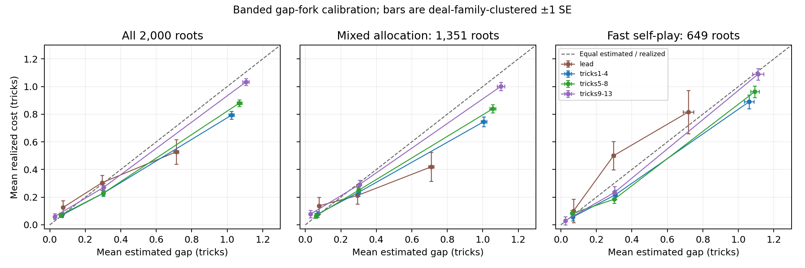

# Gen 7 capture: first 2,000 non-BEN root tables

Snapshot generated 2026-11-11T09:34:42.436653+00:00. This collector only; no model or allocation changes were made for analysis.

The sample is the first 2,000 completed physical non-BEN root tables with the `gap_forks` field, ordered by episode completion time, cohort, episode index and record order. Forks are training continuations, not independent boards. BEN and passed-out records without capture do not enter the root threshold. Every selected episode and its other tables was legally replayed.

There are **1,257 independent gap-capture deal families**, **11,534 gap forks** and **18,272 physical tie-audit forks** attached to these roots. Mixed allocation contributes 1,351 roots; fast self-play contributes 649 roots.

## Findings

- Gap capture produced 5.77 forks/root and added 57.9% of root CPU, close to the note's approximate 55% expectation. 118 of 11652 drawn forks were skipped by the CPU budget.
- Across these deliberately banded forks, mean estimated cost was 0.472 tricks versus 0.397 realized. The paired residual was -0.0746 ± 0.0095 tricks. This selected-fork calibration is not an estimate of deployment error rates or a policy strength gain.
- Residual ICC was 0.175 overall, but 0.239 in the mixed cohort and 0.032 in self-play. Pooling the two obscures an allocation-related difference.
- Touching-card controls still show early-game continuation noise; observed late touching-card changes are zero in this sample. Zero empirical variation is not proof of zero population noise.

## Capture volume and CPU

| Allocation phase | Roots | Families | Gap forks/root | Root CPU s/root | Gap CPU / root CPU | Tie CPU / root CPU | Total CPU / root CPU |
|---|---:|---:|---:|---:|---:|---:|---:|
| all | 2000 | 1257 | 5.767 | 8.764 | 57.9% | 27.1% | 1.850 |
| mixed_capture | 1351 | 608 | 5.672 | 8.682 | 58.3% | 19.2% | 1.775 |
| fast_selfplay | 649 | 649 | 5.965 | 8.933 | 57.0% | 43.0% | 2.001 |

Gap CPU is additional to the unchanged tie audits. Ratios are sums of CPU, not averages of per-root percentages. The 1.5× cap checks CPU already spent and finishes an admitted tail, so a single root can exceed it.

| Phase | Gap band | Executed forks | Forks/root | Budget skips |
|---|---|---:|---:|---:|
| all | (0,0.125] | 3823 | 1.911 | 37 |
| all | (0.125,0.5] | 3834 | 1.917 | 34 |
| all | (0.5,infinity) | 3877 | 1.938 | 47 |
| mixed_capture | (0,0.125] | 2533 | 1.875 | 30 |
| mixed_capture | (0.125,0.5] | 2544 | 1.883 | 27 |
| mixed_capture | (0.5,infinity) | 2586 | 1.914 | 40 |
| fast_selfplay | (0,0.125] | 1290 | 1.988 | 7 |
| fast_selfplay | (0.125,0.5] | 1290 | 1.988 | 7 |
| fast_selfplay | (0.5,infinity) | 1291 | 1.989 | 7 |

## Observed throughput

Rates below are (completed deals − 1) divided by the interval between first and last included completions. They include intervening stalls/restarts, exclude initial warmup, and are descriptive wall-clock rates. Mixed capture and self-play are different workloads: self-play has one root per family and four Gen6 seats. Do not attribute the full before/after rate difference to gap capture. The short pre-capture baseline used BEN32 rather than BEN64; non-BEN rates still share wall time with the rest of the workload.

| Phase | Completed deals | Interval hours | All deals/hour | Non-BEN deals/hour |
|---|---:|---:|---:|---:|
| pre_capture_mixed | 262 | 0.507 | 514.7 | 461.5 |
| mixed_capture | 724 | 1.987 | 363.8 | 305.9 |
| fast_selfplay | 740 | 1.132 | 653.1 | 574.4 |

Each phase’s throughput window ends at its last selected non-BEN root completion. This leaves one later BEN completion from the retired mixed cohort outside that rate window; all 725 retired episodes remain preserved and were checked before the overall cutoff. The self-play window also contains BEN and passed-out completions, which do not enter the 2,000-root count.

The in-process CPU ratios isolate the measured gap-tail cost more directly than these throughput comparisons. No controlled production rate experiment was run.

## Estimated gap versus realized cost

Each cell reports an unweighted mean ± one deal-family-clustered standard error. Clustering spans rooms, auction conditions and forks of the same original family. Lead is ply 0; tricks 1–4 excludes the lead. Cost is parent minus forced continuation from the acting partnership’s perspective, positive when the forced card costs tricks/IMPs. Residual is realized trick cost minus estimated gap. These are local continuation contrasts, not whole-bot strength estimates.

### all

| Band | Phase | Forks | Families | Estimated tricks ± SE | Realized tricks ± SE | Residual ± SE | Realized IMPs ± SE |
|---|---|---:|---:|---:|---:|---:|---:|
| (0,0.125] | lead | 319 | 291 | 0.0750 ± 0.0020 | 0.1254 ± 0.0504 | 0.0504 ± 0.0504 | 0.5329 ± 0.2284 |
| (0,0.125] | tricks1-4 | 1673 | 956 | 0.0683 ± 0.0009 | 0.0699 ± 0.0171 | 0.0016 ± 0.0172 | 0.3712 ± 0.0909 |
| (0,0.125] | tricks5-8 | 1382 | 872 | 0.0611 ± 0.0011 | 0.0709 ± 0.0145 | 0.0099 ± 0.0144 | 0.1671 ± 0.0640 |
| (0,0.125] | tricks9-13 | 449 | 379 | 0.0277 ± 0.0019 | 0.0601 ± 0.0195 | 0.0324 ± 0.0194 | 0.1982 ± 0.0844 |
| (0.125,0.5] | lead | 404 | 364 | 0.2941 ± 0.0053 | 0.3045 ± 0.0540 | 0.0103 ± 0.0536 | 0.8366 ± 0.2289 |
| (0.125,0.5] | tricks1-4 | 1594 | 945 | 0.3017 ± 0.0028 | 0.2284 ± 0.0213 | -0.0733 ± 0.0212 | 0.8676 ± 0.1121 |
| (0.125,0.5] | tricks5-8 | 1394 | 868 | 0.3007 ± 0.0030 | 0.2281 ± 0.0188 | -0.0725 ± 0.0188 | 0.7819 ± 0.0902 |
| (0.125,0.5] | tricks9-13 | 442 | 357 | 0.3041 ± 0.0052 | 0.2715 ± 0.0260 | -0.0326 ± 0.0254 | 0.9706 ± 0.1507 |
| (0.5,infinity) | lead | 180 | 165 | 0.7123 ± 0.0133 | 0.5278 ± 0.0883 | -0.1845 ± 0.0864 | 1.2056 ± 0.3540 |
| (0.5,infinity) | tricks1-4 | 1311 | 840 | 1.0243 ± 0.0142 | 0.7933 ± 0.0289 | -0.2310 ± 0.0271 | 2.9390 ± 0.1531 |
| (0.5,infinity) | tricks5-8 | 1478 | 931 | 1.0688 ± 0.0140 | 0.8809 ± 0.0241 | -0.1879 ± 0.0210 | 3.1035 ± 0.1299 |
| (0.5,infinity) | tricks9-13 | 908 | 649 | 1.1054 ± 0.0177 | 1.0330 ± 0.0241 | -0.0723 ± 0.0164 | 3.9020 ± 0.1693 |

### mixed_capture

| Band | Phase | Forks | Families | Estimated tricks ± SE | Realized tricks ± SE | Residual ± SE | Realized IMPs ± SE |
|---|---|---:|---:|---:|---:|---:|---:|
| (0,0.125] | lead | 219 | 191 | 0.0768 ± 0.0024 | 0.1370 ± 0.0626 | 0.0602 ± 0.0626 | 0.3744 ± 0.2755 |
| (0,0.125] | tricks1-4 | 1112 | 522 | 0.0684 ± 0.0012 | 0.0764 ± 0.0215 | 0.0081 ± 0.0216 | 0.3489 ± 0.1113 |
| (0,0.125] | tricks5-8 | 920 | 485 | 0.0599 ± 0.0014 | 0.0652 ± 0.0182 | 0.0053 ± 0.0181 | 0.1076 ± 0.0807 |
| (0,0.125] | tricks9-13 | 282 | 226 | 0.0298 ± 0.0026 | 0.0780 ± 0.0259 | 0.0482 ± 0.0258 | 0.1915 ± 0.0811 |
| (0.125,0.5] | lead | 274 | 234 | 0.2928 ± 0.0065 | 0.2117 ± 0.0623 | -0.0811 ± 0.0620 | 0.4161 ± 0.2735 |
| (0.125,0.5] | tricks1-4 | 1058 | 516 | 0.2995 ± 0.0035 | 0.2344 ± 0.0270 | -0.0651 ± 0.0269 | 0.9924 ± 0.1475 |
| (0.125,0.5] | tricks5-8 | 924 | 483 | 0.3005 ± 0.0036 | 0.2500 ± 0.0245 | -0.0505 ± 0.0244 | 0.8106 ± 0.1132 |
| (0.125,0.5] | tricks9-13 | 288 | 217 | 0.3052 ± 0.0064 | 0.2917 ± 0.0327 | -0.0135 ± 0.0319 | 0.9618 ± 0.1753 |
| (0.5,infinity) | lead | 131 | 116 | 0.7098 ± 0.0146 | 0.4198 ± 0.1044 | -0.2900 ± 0.1017 | 0.7252 ± 0.4269 |
| (0.5,infinity) | tricks1-4 | 884 | 477 | 1.0066 ± 0.0162 | 0.7466 ± 0.0351 | -0.2600 ± 0.0343 | 2.7964 ± 0.1890 |
| (0.5,infinity) | tricks5-8 | 986 | 512 | 1.0567 ± 0.0170 | 0.8398 ± 0.0292 | -0.2169 ± 0.0264 | 2.9533 ± 0.1640 |
| (0.5,infinity) | tricks9-13 | 585 | 377 | 1.1020 ± 0.0217 | 1.0017 ± 0.0294 | -0.1003 ± 0.0206 | 3.6034 ± 0.2033 |

### fast_selfplay

| Band | Phase | Forks | Families | Estimated tricks ± SE | Realized tricks ± SE | Residual ± SE | Realized IMPs ± SE |
|---|---|---:|---:|---:|---:|---:|---:|
| (0,0.125] | lead | 100 | 100 | 0.0709 ± 0.0036 | 0.1000 ± 0.0847 | 0.0291 ± 0.0844 | 0.8800 ± 0.4071 |
| (0,0.125] | tricks1-4 | 561 | 434 | 0.0681 ± 0.0015 | 0.0570 ± 0.0281 | -0.0111 ± 0.0281 | 0.4153 ± 0.1579 |
| (0,0.125] | tricks5-8 | 462 | 387 | 0.0633 ± 0.0019 | 0.0823 ± 0.0238 | 0.0189 ± 0.0238 | 0.2857 ± 0.1041 |
| (0,0.125] | tricks9-13 | 167 | 153 | 0.0243 ± 0.0028 | 0.0299 ± 0.0287 | 0.0056 ± 0.0286 | 0.2096 ± 0.1814 |
| (0.125,0.5] | lead | 130 | 130 | 0.2969 ± 0.0092 | 0.5000 ± 0.1026 | 0.2031 ± 0.1016 | 1.7231 ± 0.4057 |
| (0.125,0.5] | tricks1-4 | 536 | 429 | 0.3060 ± 0.0047 | 0.2164 ± 0.0344 | -0.0896 ± 0.0340 | 0.6213 ± 0.1614 |
| (0.125,0.5] | tricks5-8 | 470 | 385 | 0.3009 ± 0.0053 | 0.1851 ± 0.0284 | -0.1158 ± 0.0281 | 0.7255 ± 0.1489 |
| (0.125,0.5] | tricks9-13 | 154 | 140 | 0.3020 ± 0.0091 | 0.2338 ± 0.0426 | -0.0683 ± 0.0416 | 0.9870 ± 0.2832 |
| (0.5,infinity) | lead | 49 | 49 | 0.7188 ± 0.0298 | 0.8163 ± 0.1561 | 0.0976 ± 0.1548 | 2.4898 ± 0.5840 |
| (0.5,infinity) | tricks1-4 | 427 | 363 | 1.0609 ± 0.0277 | 0.8899 ± 0.0504 | -0.1710 ± 0.0429 | 3.2342 ± 0.2602 |
| (0.5,infinity) | tricks5-8 | 492 | 419 | 1.0930 ± 0.0243 | 0.9634 ± 0.0419 | -0.1296 ± 0.0345 | 3.4045 ± 0.2096 |
| (0.5,infinity) | tricks9-13 | 323 | 272 | 1.1114 ± 0.0308 | 1.0898 ± 0.0415 | -0.0217 ± 0.0269 | 4.4427 ± 0.2981 |

## Within-root residual correlation

One-way random-intercept ANOVA ICC with the unbalanced cluster-size correction, applied to realized trick cost minus estimated gap. Intervals are percentile intervals from 1,000 bootstrap resamples of deal families, retaining all their roots and forks. Negative estimates, if present, are not truncated. Different gap bands and phases remain mixed within roots; this is a descriptive clustering measure, not an independently identified causal parameter.

| Phase | ICC | Family-bootstrap 95% interval | Roots with forks |
|---|---:|---|---:|
| all | 0.1747 | 0.1501, 0.1986 | 2000 |
| mixed_capture | 0.2393 | 0.2103, 0.2686 | 1351 |
| fast_selfplay | 0.0324 | 0.0055, 0.0612 | 649 |

## Tie-audit noise control

The note does not publish a formal touching-card predicate. The primary definition here is conservative: **same suit and numerically adjacent ranks**, e.g. K/Q or 8/7. Same-card audits are excluded because they do not produce a physical alternative. Root-parent audits are the closest comparison to root-only gap forks; a separate panel includes recursive audits. A sensitivity panel additionally treats a pair as equivalent when every intervening unplayed rank is held by that same seat (played ranks are ignored). This broader rule uses the recorded full deal only for offline classification, never player inputs.

Values are mean ± family-clustered SE; changed-result percentages use trick-result differences, with clustered SE in percentage points. Estimated trick differences are zero to numerical tolerance.

### all: root_audits

| Swap | Phase | Forks | Families | Estimated ± SE | Realized tricks ± SE | Realized IMPs ± SE | Trick result differs % ± SE |
|---|---|---:|---:|---:|---:|---:|---:|
| touching | lead | 45 | 45 | 0.0000 ± 0.0000 | 0.0222 ± 0.0673 | -0.2222 ± 0.3063 | 13.33 ± 5.12 |
| touching | tricks1-4 | 505 | 421 | 0.0000 ± 0.0000 | -0.0198 ± 0.0153 | -0.0752 ± 0.0651 | 7.92 ± 1.19 |
| touching | tricks5-8 | 430 | 357 | 0.0000 ± 0.0000 | 0.0070 ± 0.0077 | 0.0209 ± 0.0449 | 2.09 ± 0.76 |
| touching | tricks9-13 | 181 | 169 | 0.0000 ± 0.0000 | 0.0000 ± 0.0000 | 0.0000 ± 0.0000 | 0.00 ± 0.00 |
| non_touching | lead | 81 | 79 | 0.0000 ± 0.0000 | 0.0123 ± 0.0541 | 0.1852 ± 0.4218 | 16.05 ± 4.12 |
| non_touching | tricks1-4 | 1437 | 874 | 0.0000 ± 0.0000 | 0.0195 ± 0.0113 | 0.0675 ± 0.0620 | 10.58 ± 0.90 |
| non_touching | tricks5-8 | 1815 | 926 | 0.0000 ± 0.0000 | 0.0050 ± 0.0057 | 0.0066 ± 0.0228 | 4.19 ± 0.53 |
| non_touching | tricks9-13 | 1983 | 979 | 0.0000 ± 0.0000 | 0.0015 ± 0.0024 | 0.0045 ± 0.0093 | 1.06 ± 0.26 |

### all: all_audits

| Swap | Phase | Forks | Families | Estimated ± SE | Realized tricks ± SE | Realized IMPs ± SE | Trick result differs % ± SE |
|---|---|---:|---:|---:|---:|---:|---:|
| touching | lead | 45 | 45 | 0.0000 ± 0.0000 | 0.0222 ± 0.0673 | -0.2222 ± 0.3063 | 13.33 ± 5.12 |
| touching | tricks1-4 | 731 | 503 | 0.0000 ± 0.0000 | -0.0068 ± 0.0140 | -0.0356 ± 0.0617 | 7.52 ± 1.07 |
| touching | tricks5-8 | 1131 | 599 | 0.0000 ± 0.0000 | -0.0009 ± 0.0058 | -0.0009 ± 0.0308 | 2.39 ± 0.64 |
| touching | tricks9-13 | 793 | 441 | 0.0000 ± 0.0000 | 0.0000 ± 0.0000 | 0.0000 ± 0.0000 | 0.00 ± 0.00 |
| non_touching | lead | 81 | 79 | 0.0000 ± 0.0000 | 0.0123 ± 0.0541 | 0.1852 ± 0.4218 | 16.05 ± 4.12 |
| non_touching | tricks1-4 | 2203 | 928 | 0.0000 ± 0.0000 | 0.0082 ± 0.0092 | 0.0359 ± 0.0457 | 9.40 ± 0.77 |
| non_touching | tricks5-8 | 5251 | 1103 | 0.0000 ± 0.0000 | 0.0046 ± 0.0032 | 0.0206 ± 0.0159 | 3.52 ± 0.38 |
| non_touching | tricks9-13 | 8037 | 1180 | 0.0000 ± 0.0000 | 0.0011 ± 0.0014 | -0.0016 ± 0.0070 | 0.61 ± 0.13 |

### mixed_capture: root_audits

| Swap | Phase | Forks | Families | Estimated ± SE | Realized tricks ± SE | Realized IMPs ± SE | Trick result differs % ± SE |
|---|---|---:|---:|---:|---:|---:|---:|
| touching | lead | 19 | 19 | 0.0000 ± 0.0000 | 0.1579 ± 0.0859 | 0.3158 ± 0.2170 | 15.79 ± 8.59 |
| touching | tricks1-4 | 262 | 209 | 0.0000 ± 0.0000 | -0.0267 ± 0.0256 | -0.1260 ± 0.1133 | 10.69 ± 1.89 |
| touching | tricks5-8 | 220 | 179 | 0.0000 ± 0.0000 | 0.0182 ± 0.0110 | 0.0773 ± 0.0638 | 1.82 ± 1.10 |
| touching | tricks9-13 | 94 | 87 | 0.0000 ± 0.0000 | 0.0000 ± 0.0000 | 0.0000 ± 0.0000 | 0.00 ± 0.00 |
| non_touching | lead | 39 | 37 | 0.0000 ± 0.0000 | -0.0256 ± 0.0687 | -0.4615 ± 0.3843 | 10.26 ± 4.95 |
| non_touching | tricks1-4 | 738 | 433 | 0.0000 ± 0.0000 | 0.0203 ± 0.0168 | 0.0054 ± 0.0850 | 12.06 ± 1.28 |
| non_touching | tricks5-8 | 920 | 460 | -0.0000 ± 0.0000 | -0.0022 ± 0.0086 | -0.0337 ± 0.0348 | 4.24 ± 0.69 |
| non_touching | tricks9-13 | 1001 | 479 | 0.0000 ± 0.0000 | 0.0060 ± 0.0042 | 0.0120 ± 0.0071 | 1.40 ± 0.42 |

### mixed_capture: all_audits

| Swap | Phase | Forks | Families | Estimated ± SE | Realized tricks ± SE | Realized IMPs ± SE | Trick result differs % ± SE |
|---|---|---:|---:|---:|---:|---:|---:|
| touching | lead | 19 | 19 | 0.0000 ± 0.0000 | 0.1579 ± 0.0859 | 0.3158 ± 0.2170 | 15.79 ± 8.59 |
| touching | tricks1-4 | 340 | 237 | 0.0000 ± 0.0000 | -0.0029 ± 0.0259 | -0.0971 ± 0.0998 | 10.00 ± 1.73 |
| touching | tricks5-8 | 468 | 280 | 0.0000 ± 0.0000 | 0.0085 ± 0.0113 | 0.0363 ± 0.0675 | 2.99 ± 1.11 |
| touching | tricks9-13 | 305 | 189 | 0.0000 ± 0.0000 | 0.0000 ± 0.0000 | 0.0000 ± 0.0000 | 0.00 ± 0.00 |
| non_touching | lead | 39 | 37 | 0.0000 ± 0.0000 | -0.0256 ± 0.0687 | -0.4615 ± 0.3843 | 10.26 ± 4.95 |
| non_touching | tricks1-4 | 981 | 449 | 0.0000 ± 0.0000 | 0.0092 ± 0.0145 | -0.0296 ± 0.0657 | 11.01 ± 1.15 |
| non_touching | tricks5-8 | 2041 | 533 | -0.0000 ± 0.0000 | 0.0020 ± 0.0058 | 0.0108 ± 0.0274 | 3.87 ± 0.55 |
| non_touching | tricks9-13 | 3066 | 565 | 0.0000 ± 0.0000 | 0.0033 ± 0.0023 | 0.0049 ± 0.0030 | 0.95 ± 0.23 |

### fast_selfplay: root_audits

| Swap | Phase | Forks | Families | Estimated ± SE | Realized tricks ± SE | Realized IMPs ± SE | Trick result differs % ± SE |
|---|---|---:|---:|---:|---:|---:|---:|
| touching | lead | 26 | 26 | 0.0000 ± 0.0000 | -0.0769 ± 0.0948 | -0.6154 ± 0.4964 | 11.54 ± 6.39 |
| touching | tricks1-4 | 243 | 212 | 0.0000 ± 0.0000 | -0.0123 ± 0.0160 | -0.0206 ± 0.0582 | 4.94 ± 1.38 |
| touching | tricks5-8 | 210 | 178 | 0.0000 ± 0.0000 | -0.0048 ± 0.0107 | -0.0381 ± 0.0624 | 2.38 ± 1.05 |
| touching | tricks9-13 | 87 | 82 | 0.0000 ± 0.0000 | 0.0000 ± 0.0000 | 0.0000 ± 0.0000 | 0.00 ± 0.00 |
| non_touching | lead | 42 | 42 | 0.0000 ± 0.0000 | 0.0476 ± 0.0831 | 0.7857 ± 0.7242 | 21.43 ± 6.41 |
| non_touching | tricks1-4 | 699 | 441 | 0.0000 ± 0.0000 | 0.0186 ± 0.0149 | 0.1330 ± 0.0903 | 9.01 ± 1.27 |
| non_touching | tricks5-8 | 895 | 466 | 0.0000 ± 0.0000 | 0.0123 ± 0.0075 | 0.0480 ± 0.0294 | 4.13 ± 0.80 |
| non_touching | tricks9-13 | 982 | 500 | 0.0000 ± 0.0000 | -0.0031 ± 0.0023 | -0.0031 ± 0.0174 | 0.71 ± 0.30 |

### fast_selfplay: all_audits

| Swap | Phase | Forks | Families | Estimated ± SE | Realized tricks ± SE | Realized IMPs ± SE | Trick result differs % ± SE |
|---|---|---:|---:|---:|---:|---:|---:|
| touching | lead | 26 | 26 | 0.0000 ± 0.0000 | -0.0769 ± 0.0948 | -0.6154 ± 0.4964 | 11.54 ± 6.39 |
| touching | tricks1-4 | 391 | 266 | 0.0000 ± 0.0000 | -0.0102 ± 0.0135 | 0.0179 ± 0.0761 | 5.37 ± 1.32 |
| touching | tricks5-8 | 663 | 319 | 0.0000 ± 0.0000 | -0.0075 ± 0.0058 | -0.0271 ± 0.0219 | 1.96 ± 0.77 |
| touching | tricks9-13 | 488 | 252 | 0.0000 ± 0.0000 | 0.0000 ± 0.0000 | 0.0000 ± 0.0000 | 0.00 ± 0.00 |
| non_touching | lead | 42 | 42 | 0.0000 ± 0.0000 | 0.0476 ± 0.0831 | 0.7857 ± 0.7242 | 21.43 ± 6.41 |
| non_touching | tricks1-4 | 1222 | 479 | 0.0000 ± 0.0000 | 0.0074 ± 0.0118 | 0.0884 ± 0.0632 | 8.10 ± 1.03 |
| non_touching | tricks5-8 | 3210 | 570 | 0.0000 ± 0.0000 | 0.0062 ± 0.0038 | 0.0268 ± 0.0193 | 3.30 ± 0.52 |
| non_touching | tricks9-13 | 4971 | 615 | 0.0000 ± 0.0000 | -0.0002 ± 0.0018 | -0.0056 ± 0.0111 | 0.40 ± 0.15 |

### Effective touching sensitivity, root-parent audits

| Phase | Swap | Forks | Realized tricks ± SE | Trick result differs % ± SE |
|---|---|---:|---:|---:|
| all | touching | 2517 | -0.0024 ± 0.0045 | 3.06 ± 0.38 |
| all | non_touching | 3960 | 0.0104 ± 0.0052 | 6.06 ± 0.45 |
| mixed_capture | touching | 1277 | -0.0008 ± 0.0073 | 3.99 ± 0.62 |
| mixed_capture | non_touching | 2016 | 0.0094 ± 0.0081 | 6.45 ± 0.60 |
| fast_selfplay | touching | 1240 | -0.0040 ± 0.0050 | 2.10 ± 0.43 |
| fast_selfplay | non_touching | 1944 | 0.0113 ± 0.0065 | 5.66 ± 0.66 |

## Validation, provenance and limits

- Verified 1,465 episode receipts and hashes; replayed 32,287 recorded tables, including BEN records encountered before the cutoff. Manifest identities, frozen model/source hashes, auctions and score orientation passed.
- Recomputed gap selections from their dedicated stream, checked draw propensities, budget-skip accounting, forced prefixes and realized trick/IMP costs. The stored propensity is the design draw probability before budget admission; it is not asserted to be a full post-budget execution inclusion probability.
- All calibration means are conditional on executed banded forks, without inverse-propensity weighting. Selected positions/cards and budget stops do not represent uniformly sampled real-play errors. Realized contrasts include continuation sampling noise, as the tie controls demonstrate.
- Families are disjoint across the two immutable cohorts. Self-play comparison IMPs remain null; no forks are counted as independent boards. No data were rewritten, no backfill was run, and no model was trained, promoted or replaced.
- The statistics are descriptive at the requested 2,000-root collection milestone. Multiple band/phase panels are not multiplicity-adjusted; these tables do not establish a strength improvement or justify an automatic budget change.

Frozen cohort identities:

- `mixed_capture`: `a76a39f13d9d7046b6591c8f109beb7d8001d3a714c57485a663ef99829912bb`; allocation `{"6-256~ben64": 3, "6-32~1": 4, "6-32~2": 4, "6-32~3": 4, "6-32~5RZ32": 16, "6-32~6-256": 6, "6-32~ben": 3}`.
- `fast_selfplay`: `63d7bee704eae61f070af1dca0476e2171b66b4fb084a1b78c11df18d76ed5e7`; allocation `{"6-32~6-32": 37, "6-32~ben": 3}`.

The companion JSON contains all cell statistics, confidence intervals, CPU quantiles and the selected episode/hash/root inventory. Bulk episodes remain in their existing recovery feeds.
